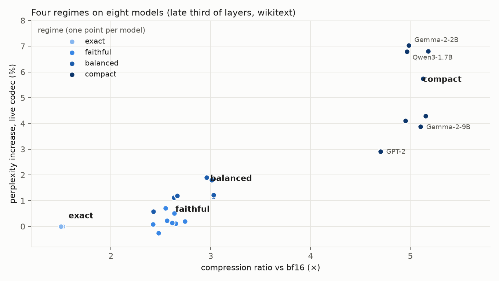

# rescomp

Compress the residual-stream activations of a running transformer and keep them, with the tokens, labels and
model metadata that interpretability work needs later. Pure PyTorch + zstd + Parquet, CPU or GPU, any framework
whose layers are `nn.Module`s. The model is not wrapped: you add a sink, run the model as you always do, and read
the files afterwards.

- `DESIGN.md`: the design decisions behind the sink and the storage layout.
- `RESULTS.md`: what each codec costs, measured on eight models (GPT-2 to Qwen3-30B-A3B, dense and MoE).
- `PLAN.md`: the original one-page plan.

## Install

```bash
pip install -e .            # torch>=2.8, numpy, zstandard, pyarrow, torchao
pip install -e '.[hf]'      # + transformers, datasets
pytest                      # ~210 tests, CPU only, under a minute
```

## Use

```python
import torch, rescomp as rc
from transformers import AutoModelForCausalLM, AutoTokenizer

tok = AutoTokenizer.from_pretrained("Qwen/Qwen3-8B")
model = AutoModelForCausalLM.from_pretrained("Qwen/Qwen3-8B", dtype=torch.bfloat16).cuda().eval()
batch = tok(["The history of the Roman Empire", "To make a tomato sauce, first"], return_tensors="pt", padding=True).to("cuda")

sink = rc.Sink("runs/demo", layers=rc.hf_layers(model, [24, 28, 32, 35]),
               spec="balanced")                                           # a regime, or any spec string
with sink, torch.no_grad():
    logits = model(**batch).logits                 # one forward call = one chunk
    out = model.generate(**batch, max_new_tokens=80)   # prompt + steps = one sequence per prompt
print(sink.stats())                                # chunks, sequences, bytes, ratio, per-layer rel L2

r = rc.open("runs/demo")
r.sequences()                                      # Parquet table: seq_id, n_tokens, tokens, mask, annotations
x = r.read(32, seqs=[2, 3])                        # each sequence whole, [T_i, d] fp32 (the encoder's own reconstruction)
r.tokens(2); r.header["model"]; r.header["layers"][1]["fidelity"]
```

- `layers`: `rc.hf_layers(model, [...])` for Hugging Face, `rc.tl_layers(model, [...])` for TransformerLens, or
  any `{layer: nn.Module}` whose outputs are the residual stream (then pass `rc.Layers(modules=..., root=model)`
  if you want the token pre-hook).
- The hook quantizes on the model's device (cheap kernels), starts asynchronous copies of the encoded streams to
  pinned host memory and returns without synchronizing. zstd and the file writes run at `sink.flush()`, when the
  host buffer passes `buffer_bytes`, and at close. `scripts/sink_overhead.py` measures the added forward time.
- Tokens: taken from each call by a pre-hook on the root model (`input_ids`, `attention_mask`, and the KV-cache
  signal that tells a generation step from a new prompt); `sink.tokens(ids)` overrides, `tokens="off"` disables.
- `sink.annotate(doc_id=[...], split="train")` labels the sequences the next new-sequence call starts; labels become
  Parquet columns.
- Outlier channels (`+out`) are calibrated on the first chunk unless `calib=` is given.

### Storage (format 2)

`<stem>.00000.rsc, ...` hold only the compressed tensor blobs (append-only, rotated at `rotate_bytes`, 4 GB by
default). `<stem>.meta.parquet` has the model, spec, calibration, stored layers with hook names and measured
fidelity, and byte counts; `<stem>.chunks.parquet` which sequences each chunk holds and where; `<stem>.blobs.parquet`
one row per blob (byte range, crc, dtype, shape); `<stem>.tokens.parquet` one row per sequence (tokens, mask,
annotations).

### Lower level

`rc.encode(X, spec, calib)` / `rc.decode(streams, spec, calib)` on an `[L, B, T, d]` stack; `rc.Encoder(...)
.encode_layer(i, x)` one layer at a time (closed-loop deltas); `rc.Store` to write encoded chunks yourself;
`rc.transcode(src, dst, spec)` to re-encode a stored capture with another spec or regime.

## Regimes

Four named settings cover the useful range; pass one as `spec=`. Each is a spec template whose group and
outlier counts scale with the model width `d` (resolved when the sink sees its first batch).

| Regime | Spec | Keep in mind |
|---|---|---|
| `exact` | `fp16` | bit-exact for bf16 models |
| `faithful` | `int8_tok+out8` | every layer at single-layer KL ≈ 0.001 |
| `balanced` | `int4_g(d/8)+layerK4+out(d/128)+key=bf16` | every 4th layer stored exactly; the rest at KL ≤ 0.005 |
| `compact` | `int4_g(d/8)+layerK4+out(d/128)` | the 5× point; small models pay more |

Measured on eight models (compression ratio vs bf16 / perplexity change with the codec live in the forward pass,
late third of layers, wikitext; details and per-layer numbers in `RESULTS.md`):

| Model | `exact` | `faithful` | `balanced` | `compact` |
|---|---|---|---|---|
| GPT-2 | 1.5× / +0.0% | 2.4× / +0.1% | 3.0× / +1.9% | 4.7× / +2.9% |
| Qwen3-1.7B | 1.5× / +0.0% | 2.5× / -0.3% | 2.6× / +1.1% | 5.0× / +6.8% |
| Gemma-2-2B | 1.5× / +0.0% | 2.6× / +0.2% | 2.7× / +1.2% | 5.0× / +7.0% |
| Qwen3-8B | 1.5× / +0.0% | 2.6× / +0.1% | 3.0× / +1.8% | 5.2× / +6.8% |
| Qwen3-14B | 1.5× / +0.0% | 2.6× / +0.1% | 3.0× / +1.2% | 5.2× / +4.3% |
| Gemma-2-9B | 1.5× / +0.0% | 2.6× / +0.5% | 3.0× / +1.2% | 5.1× / +3.9% |
| OLMoE-1B-7B (MoE) | 1.5× / +0.0% | 2.5× / +0.7% | 2.4× / +0.6% | 5.0× / +4.1% |
| Qwen3-30B-A3B (MoE) | 1.5× / +0.0% | 2.7× / +0.2% | 3.0× / +1.8% | 5.1× / +5.7% |



## Specs

Anything beyond the four regimes is a spec string: `<quant>[+layerK<K>][+out<n>][+sink<s>][+key=<quant>]`

| Part | Meaning |
|---|---|
| `fp32`, `bf16`, `fp16` | plain casts (bf16 is lossless for a bf16 model; fp16 too, at 1.5×), then byte-shuffle + zstd |
| `fp8_e4m3`, `int8_tok` | 8-bit codes with one fp16 scale per token |
| `int4_g<G>`, `int8_g<G>` | torchao affine codes (symmetric, no clipping, full range) with one fp16 scale per group of G channels (G must divide d) |
| `uabs<step>` | fixed step in activation units; zigzag integer codes in byte planes, so zstd does the entropy coding |
| `mxfp4`, `nvfp4` | torchao's OCP MX / NVIDIA FP4: e2m1 codes with an e8m0 scale per 32 or an e4m3 scale per 16 channels |
| `+layerK<K>` | code stored layer i as `x_i - xhat_{i-1}` except every K-th layer (closed loop, so errors do not accumulate) |
| `+out<n>` | keep the n highest-energy channels of each layer in bf16 (calibrated; stored in the header) |
| `+sink<s>` | keep the first s tokens of every sequence in bf16 |
| `+key=<quant>` | hybrid: keyframe layers use this quantizer (`key=bf16` keeps every K-th layer exact) |

Beyond the regimes, `uabs(0.1·rms)+out8` is worth knowing: 3.0× at ≤ 0.6% perplexity with no exact layers
(the step must be set from the activations' rms). `nvfp4+layerK4+out8` gives 3.7× at +0.5–2%.

## Instrumentation (separate from the sink)

`rescomp.instrument` feeds reconstructions back into a running model and measures the change, with the same
module-object convention and any `run(tokens) -> logits` callable:

```python
from rescomp import instrument as I
L = rc.hf_layers(model, [24, 28, 32, 35])
run = lambda t: model(t, use_cache=False).logits
I.kl_ppl(run, tokens, I.Patcher(L, I.LiveCodec("int4_g512+layerK4+out32")))   # codec inside the forward pass
I.kl_ppl(run, tokens, I.Patcher(L, rc.open("runs/demo")), seq_ids=range(64))  # stored reconstructions
I.per_layer(run, tokens, L, I.LiveCodec("int8_tok+out8"))                       # one layer at a time
I.coherence(run, prompts, I.Patcher(L, I.LiveCodec(spec)), tokenizer=tok)       # generation, paired perplexity
```

`scripts/run_models.py` runs the study in RESULTS.md with these pieces (capture once with the `exact` regime,
`rc.transcode` to each spec, then the measurements).
